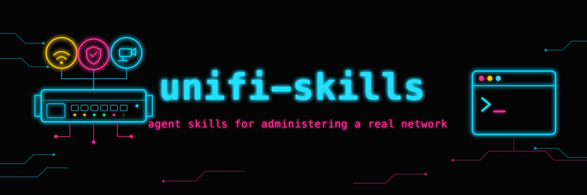

<!-- the config said isolated. the network said otherwise. -->

<p align="center">
  
</p>

<p align="center">
  <a href="LICENSE"></a>
  <a href="https://github.com/t3chnaztea/unifi-skills/releases"></a>
  
  
  
</p>

<p align="center">
  <b>Point a coding agent at a real multi-VLAN UniFi network without finding every trap yourself, at midnight, from the wrong side of a firewall rule.</b>
</p>

> UniFi has a complete local API and almost no public documentation for it. It also has three overlapping API surfaces with different auth rules, endpoints that move between point releases without deprecation notices, and a habit of accepting configuration it does not actually apply. Point a coding agent at it without doctrine and you get changes that read back clean and did nothing, or a firewall zone that silently cuts your house off from its own DNS. This repo packages the doctrine as [Agent Skills](https://agentskills.io): focused, model-readable guides your coding agent loads on demand when you ask it to work on your network.

```
/plugin marketplace add t3chnaztea/unifi-skills
/plugin install unifi@t3chnaztea-unifi
```

## The five skills

**Start with `unifi-connect`.** The others assume its auth lanes, its endpoint
map, and its read-before-write doctrine.

<table>
  <tr>
    <td align="center" width="50%" valign="top">
      <a href="skills/unifi-connect/SKILL.md"><b>🔌 unifi-connect</b></a><br />
      <sub>Start here. Minting an API key <i>over the API</i>, which endpoint families accept a key and which 401, the cookie fallback, the HTTP/2 empty-body trap that makes working auth look broken, and the endpoint map. Ships the <code>udm.py</code> helper.</sub>
    </td>
    <td align="center" width="50%" valign="top">
      <a href="skills/unifi-firewall/SKILL.md"><b>🧱 unifi-firewall</b></a><br />
      <sub>Why <code>rest/firewallrule</code> returns an empty list on a firewalled network, where zone policies actually live, and the trap that costs an evening: a new zone defaults to <b>BLOCK</b> against Internal in both directions.</sub>
    </td>
  </tr>
  <tr>
    <td align="center" width="50%" valign="top">
      <a href="skills/unifi-wifi/SKILL.md"><b>📶 unifi-wifi</b></a><br />
      <sub>The diagnostic ladder for slow Wi-Fi, ending at the rung that actually finds it. Why 80&nbsp;MHz everywhere with DFS off cratered a gigabit line to 32&nbsp;Mbps at <nobr>-57&nbsp;dBm</nobr>, and how to move a radio without lying to yourself about whether it moved.</sub>
    </td>
    <td align="center" width="50%" valign="top">
      <a href="skills/unifi-clients/SKILL.md"><b>🔀 unifi-clients</b></a><br />
      <sub>Full-object PUT discipline, because partial writes reset every other port on the switch. And the wired VLAN migration trap: flipping a port's native VLAN does not bounce the link, so the device is stranded and looks fine.</sub>
    </td>
  </tr>
  <tr>
    <td align="center" colspan="2" valign="top">
      <a href="skills/unifi-context-map/SKILL.md"><b>🗺️ unifi-context-map</b></a><br />
      <sub>The part people skip. Building the site inventory this repo deliberately does not ship: verified device meanings, the reservation-vs-reality audit, an append-only Gotchas list, provenance checks that keep it honest, and a frank warning about what a complete network map is if it leaks.</sub>
    </td>
  </tr>
</table>

---

## Prior art

The `udm.py` helper here is derived from
[**dlewis7444/unifi-claude-skill**](https://github.com/dlewis7444/unifi-claude-skill)
(MIT), trimmed and reorganized. Credit where it is due: that repo is the origin
of the script, and it is the better choice if a CLI wrapper is all you need.

The split is roughly: **upstream gives your agent the API. This gives it the
playbook and the traps.** Five skills of operational doctrine, most of it
learned by getting it wrong first on a live network.

## The MCP servers, and why this is not one

There are now real MCP servers for UniFi:
[**sirkirby/unifi-mcp**](https://github.com/sirkirby/unifi-mcp) is the mature
incumbent, and [**pete-builds/mcp-unifi**](https://github.com/pete-builds/mcp-unifi)
is the safety-first one, with dry-run previews, a JSONL audit log, and composite
rollback built into the server. If you want typed tools your agent can call,
use one of them. They are good.

The same split applies: **an MCP server gives your agent the API. This gives it
the playbook.** A tool called `update_firewall_policy` will happily execute the
wrong policy perfectly. Nothing in a tool schema tells the agent that a new zone
defaults to BLOCK against Internal in both directions, that a partial PUT resets
every other port on the switch, or that the controller echoes back config it
never applied. That judgment is what these skills carry, and it is
transport-neutral: it makes the agent better over raw curl, over `udm.py`, and
over an MCP server's tools alike. Run both. They compose.

---

## ⚠️ Read before you install

**These skills direct an agent to hold an admin API key for the device that runs
your entire network.** That is exactly as powerful as it sounds. A bad firewall
write does not throw an error, it removes your ability to fix the error.

- **Review the skills before installing.** They are plain Markdown plus one
  short Python file; read what they will have your agent do. Nothing here phones
  home or auto-runs. But you are handing an agent an operating manual for your
  gateway.
- **Mint the agent its own named key**, not a copy of yours, and consider a
  limited admin account rather than your super-admin. Named keys are
  individually revocable, and when a policy appears that you did not write you
  want to know which identity wrote it.
- **Know your out-of-band path before the first firewall change.** On most UniFi
  OS gateways SSH is closed by default, so "I'd just SSH in" is often not a plan.
- **The doctrine is conservative by design:** read before write, full-object PUT,
  verify from a fresh read rather than the write's own echo, dry-run first,
  snapshot before every mutate so there is a way back, stage allow policies
  before restrictive ones. It is still your network and your risk.
- **Keep the key out of the agent's context entirely.**
  [docs/secrets-hygiene.md](docs/secrets-hygiene.md) is the short version of how:
  the agent gets the capability, never the credential.

---

## Install

### Claude Code plugin (recommended)

```
/plugin marketplace add t3chnaztea/unifi-skills
/plugin install unifi@t3chnaztea-unifi
```

The skills activate automatically when your prompt matches, e.g. "why is my
wifi slow when the router speedtest is fine", "isolate my cameras from the
internet", "my firewall rules come back empty".

### Manual copy (any Claude Code, no marketplace)

```bash
git clone https://github.com/t3chnaztea/unifi-skills
cp -r unifi-skills/skills/unifi-* ~/.claude/skills/
```

### Other harnesses

Each `SKILL.md` is harness-neutral Markdown with standard Agent-Skills
frontmatter ([spec](https://agentskills.io/specification)). Drop the `skills/*`
directories wherever your agent framework discovers skills, or point it at this
repo.

### Configure

```bash
mkdir -p ~/.config/unifi
cat > ~/.config/unifi/env <<'EOF'
UDM_HOST=192.0.2.1
UNIFI_API_KEY=your-key-here
EOF
chmod 600 ~/.config/unifi/env
```

See [`unifi-connect`](skills/unifi-connect/SKILL.md) for minting the key. Then:

```bash
python3 skills/unifi-connect/scripts/udm.py status
```

---

## What's inside a skill

```
skills/unifi-<area>/
  SKILL.md            # the guide (frontmatter + body, < 500 lines)
  scripts/udm.py      # unifi-connect only
```

**One script ships, deliberately scoped.** `udm.py` is Python standard library
only, no dependencies, no network calls other than to the host you configure,
and short enough to audit in five minutes. Everything else is doctrine plus
fenced curl recipes, so your agent writes whatever throwaway code a task needs,
fresh, against your actual controller. Read the script before you point it at
your gateway. That is not a formality: it is the advice this repo gives about
every other tool too.

Skills are original prose: operational lessons, not a copy of the manual.
Ubiquiti's docs remain the canonical reference; these capture what running a
network with agents teaches that the docs do not.

## Contributing

Have a hard-won UniFi lesson? Copy [`template/SKILL.md`](template/SKILL.md) and
follow its authoring notes: original prose, everything site-specific
parameterized, **no real inventory of any kind**, state the controller version
you verified against, and show the reader how to confirm the change rather than
just make it. PRs welcome.

Every PR validates each `SKILL.md` against the
[Agent Skills spec](https://agentskills.io/specification) via
`.github/scripts/validate_skills.py`. Run the same check before you commit with
`git config core.hooksPath .githooks`.

## More tiny tools for home labs

Agent skills: [home-assistant](https://github.com/t3chnaztea/home-assistant-skills) · [batocera](https://github.com/t3chnaztea/batocera-skills) · [psn](https://github.com/t3chnaztea/awesome-psn-skills) · [arr-stack](https://github.com/t3chnaztea/arr-stack-skills)  
Retro cabinet: [batocera-toolbox](https://github.com/t3chnaztea/batocera-toolbox) · [batocera-holidays](https://github.com/t3chnaztea/batocera-holidays)  
Home server: [dell-ipmi-fan-control](https://github.com/t3chnaztea/dell-ipmi-fan-control) · [plex-preroll-roulette](https://github.com/t3chnaztea/plex-preroll-roulette)  
PlayStation: [awesome-psnstats](https://github.com/t3chnaztea/awesome-psnstats)  
Desktop: [fastfetch-macos-gradient-hud](https://github.com/t3chnaztea/fastfetch-macos-gradient-hud)

## Versions

Verified against **UniFi OS 5.1.19 / Network 10.4.57**, mid-2026, on a UDM Pro
with AC and WiFi 6 access points and UniFi switching. Channel and DFS specifics
assume the **US regulatory domain**.

UniFi moves faster than its documentation. Between releases seen here:
`stat/event` died in favor of a v2 system-log endpoint, `/api/users` was removed
outright, the entire firewall model became zone-based while the old endpoint kept
answering with an empty list, and the HTTP/2 body behavior changed inside a point
release. Treat every claim here as a strong prior, not gospel, and confirm
against `stat/sysinfo` on your own controller. When a documented endpoint 404s,
look for a v2 equivalent first: that has been the direction of travel every time.

## License

MIT; see [LICENSE](LICENSE).

> Not affiliated with Ubiquiti Inc. "UniFi", "UniFi OS", "UniFi Protect", and
> "Dream Machine" are used descriptively; this is an independent,
> community-built collection. The vendor's site is
> [ui.com](https://ui.com).

---

The config said isolated. The network said otherwise. Verify the network.
